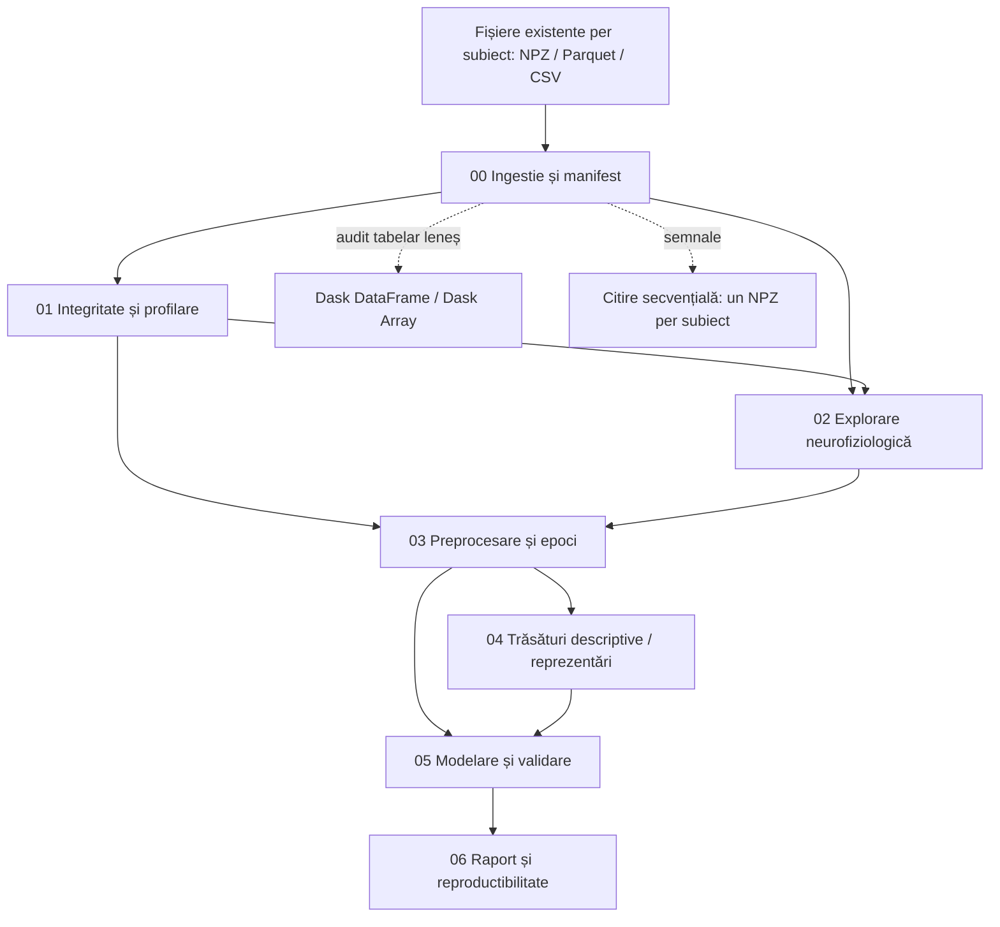
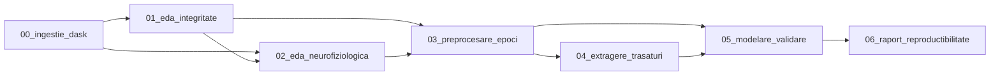

# Arhitectura pipeline-ului EEG Yang2025

> **Scopul documentului:** specifică arhitectura analizei setului Yang2025, organizarea notebook-urilor, fluxul artefactelor și verificările necesare pentru o implementare reproductibilă, scalabilă și fără scurgere de informații între antrenare și evaluare.
>
> **Limba de lucru:** română. Numele tehnologiilor, formatelor și algoritmilor sunt păstrate în forma consacrată.

## Cuprins

1. [Rezumat și obiective](#1-rezumat-și-obiective)
2. [Contextul proiectului și starea inventarului](#2-contextul-proiectului-și-starea-inventarului)
3. [Principii de proiectare](#3-principii-de-proiectare)
4. [Arhitectura generală și fluxul datelor](#4-arhitectura-generală-și-fluxul-datelor)
5. [Structura recomandată a proiectului](#5-structura-recomandată-a-proiectului)
6. [Capitolele pipeline-ului și notebook-urile](#6-capitolele-pipeline-ului-și-notebook-urile)
   - [00 — Ingestie și manifest](#61-00--ingestie-dask-i-manifest)
   - [01 — Integritate și profilarea cohortului](#62-01--integritate-i-profilarea-cohortului)
   - [02 — Explorare neurofiziologică](#63-02--explorare-neurofiziologică)
   - [03 — Preprocesare și epoci](#64-03--preprocesare-i-epoci)
   - [04 — Extragerea trăsăturilor](#65-04--extragerea-trăsăturilor)
   - [05 — Modelare și validare](#66-05--modelare-i-validare)
   - [06 — Raportare și reproductibilitate](#67-06--raportare-i-reproductibilitate)
7. [Contracte de date și convenții pentru artefacte](#7-contracte-de-date-și-convenții-pentru-artefacte)
8. [Strategia de validare și prevenirea data leakage](#8-strategia-de-validare-și-prevenirea-data-leakage)
9. [Gestionarea memoriei și scalarea la cohortul complet](#9-gestionarea-memoriei-și-scalarea-la-cohortul-complet)
10. [Criterii de acceptare și verificări](#10-criterii-de-acceptare-și-verificări)
11. [Riscuri, ipoteze și decizii care trebuie validate](#11-riscuri-ipoteze-și-decizii-care-trebuie-validate)
12. [Referințe locale](#12-referințe-locale)

---

## 1. Rezumat și obiective

Proiectul analizează semnale EEG de imaginație motorie pentru clasificarea intenției de mișcare a mâinii stângi sau drepte. Arhitectura acoperă ingestia și auditul datelor, EDA în timp și frecvență, curățarea semnalului, extragerea trăsăturilor, evaluarea modelelor și raportarea rezultatelor.

Unitatea obligatorie de procesare este **un subiect per chunk**. La început se folosesc fișierele existente pentru subiecții 01–03. Adăugarea altor subiecți trebuie să însemne doar apariția unor noi fișiere și înregistrări în manifest, nu o schimbare a logicii pipeline-ului. Niciun pas nu va concatena toate semnalele tuturor subiecților sau presupune că întregul cohort încape în RAM.

Arhitectura trebuie să permită:

- verificarea provenienței și integrității datelor înainte de prelucrare;
- prelucrarea incrementală, reproductibilă și trasabilă per subiect/sesiune;
- evitarea filtrării repetate și a interpretării greșite a ferestrelor temporale;
- evaluarea realistă a generalizării la sesiuni și subiecți noi;
- antrenarea secvențială a modelelor sau folosirea unor încărcătoare de date care citesc de pe disc;
- generarea de artefacte intermediare și rezultate comparabile între rulări.

## 2. Contextul proiectului și starea inventarului

### 2.1 Fișiere identificate

| Cale | Rol observat | Observații |
|---|---|---|
| `config.py` | Căi, canale, seed, parametri și funcții utilitare | Definește 59 de canale EEG plus ECG și patru EOG, mapare pentru coloanele `ch_*`, limitele implicite și formate de stocare. |
| `requirements.txt` | Dependențe Python | Include Dask, MOABB, NumPy, pandas, seaborn și PyArrow; pentru etapele ulterioare trebuie confirmate explicit dependențele MNE, scikit-learn și eventual PyTorch/PyRiemann. |
| `data/README.md` | Descrierea dataset-ului | Descrie Yang2025, 51 de subiecți, trei sesiuni, 1000 Hz, 59 EEG, ECG/EOG și clasele de imaginație motorie. Este documentație, nu înlocuiește verificarea artefactelor locale. |
| `data/data_sub_01.npz` … `data/data_sub_03.npz` | Array-uri per subiect | Fișiere de ordinul 1,1 GB fiecare. NPZ-ul păstrează `X`, `y` și `metadata`, conform codului din notebook-ul 00. |
| `data/data_sub_01.parquet` … `data/data_sub_03.parquet` | Semnale aplatizate în format tabelar | Aproximativ 700 MB per subiect; codul existent include eticheta, subiectul, trialul și indexul eșantionului. Sesiunea nu este scrisă explicit în schema Parquet de codul vizibil. |
| `data/X_data.csv`, `data/y_data.csv` | Exporturi CSV voluminoase | `X_data.csv` are aproximativ 9,5 GB, `y_data.csv` aproximativ 76 MB. Nu se vor încărca într-un singur DataFrame pandas. Proveniența și corespondența cu NPZ/Parquet trebuie stabilite. |
| `notebooks/00-first-step.ipynb` | Prototip de extragere MOABB și scriere | Folosește `Yang2025`, `LeftRightImagery(fmin=8, fmax=32)`, scrie Parquet/NPZ per subiect și salvează `metadata` în NPZ. |
| `notebooks/01-data-analysis.ipynb` | Schelet EDA/integritate | Încarcă Parquet cu Dask și folosește maparea din configurație. |
| `notebooks/02-explore-data.ipynb` | Schelet EDA neurofiziologică | Descrie analiza temporală, spectrală, TFR și topografii. |
| `notebooks/03-data-processing.ipynb` | Schelet de preprocesare | Descrie filtrare, ICA, CAR, epocare/decimare și split-uri. |
| `notebooks/04-data-modeling.ipynb` | Schelet modelare | Descrie CSP, FBCSP, modele Riemanniene, DL, protocoale și reducerea canalelor. |
| `docs/NOTEBOOK_INTEGRATION_PLAN.md` | Plan preexistent de integrare | Conține un blueprint detaliat, însă unele valori și aserțiuni trebuie verificate față de array-urile efective înainte de implementare. |
| `data/assets/head.png` | Imagine auxiliară | Nu este sursă de geometrie a senzorilor; montajul trebuie definit prin metadatele și numele canalelor EEG. |

### 2.2 Fapte cunoscute și aspecte neconfirmate

Codul din `00-first-step.ipynb` trece `fmin=8` și `fmax=32` către `LeftRightImagery` și salvează rezultatul `X` întors de `paradigm.get_data`. Acest lucru sugerează că datele derivate pot fi deja filtrate și epoched de MOABB. Totuși, configurația locală și documentația nu dovedesc singure forma, frecvența efectivă, momentul de referință al epocii ori dacă filtrarea a fost aplicată exact cum se presupune. **Notebook-ul de preprocesare trebuie să inspecteze datele și codul de ingestie înainte de orice filtrare.**

Următoarele neconcordanțe nu se rezolvă prin presupuneri:

- `data/README.md` indică 51 subiecți; un text din notebook-ul 00 menționează 53 canale, deși configurația enumeră 59 canale EEG;
- configurația conține 64 canale în total (59 EEG + ECG + 4 EOG), nu 68;
- codul Parquet vizibil nu păstrează coloana `session`, în timp ce NPZ-ul păstrează obiectul `metadata`;
- documentația declară rata de 1000 Hz și intervale de trial, dar array-urile derivate pot avea eșantionare sau fereastră diferită după procesarea MOABB;
- numărul trialurilor și distribuția claselor trebuie calculate din fișiere, nu codificate ca valori așteptate fără audit.

## 3. Principii de proiectare

1. **Un subiect este un chunk.** Citirea, procesarea, scrierea și eliberarea memoriei se fac înainte de trecerea la următorul subiect.
2. **Fără acumulare a cohortului.** Se păstrează în memorie doar subiectul curent, lotul curent și agregatele mici necesare raportării.
3. **Separarea formatelor după rol.** Dask DataFrame/Array se folosesc pentru acces leneș și agregări tabelare; MNE/NumPy/SciPy se folosesc pentru operații de semnal pe subiect. NPZ per subiect rămâne unitatea practică de intrare pentru array-urile existente.
4. **Proveniența se păstrează.** Fiecare epoch/trial trebuie să poată fi asociat subiectului, sesiunii când este disponibilă, etichetei și identificatorului trialului.
5. **Parametrii sunt expliciți și versionați.** Se salvează frecvențele de tăiere, rata de eșantionare, fereastra temporală, referința, regulile de artefact și seed-ul.
6. **Nicio transformare supervizată înainte de split.** CSP, scalarea învățată, selecția caracteristicilor și orice estimare care folosește etichete se antrenează în foldul curent.
7. **Datele de evaluare nu influențează modelul.** Hiperparametrii, normalizarea și pragurile nu se aleg după performanța setului de test final.
8. **Ipotezele se verifică înainte de procesare.** Metadatele lipsă nu se sintetizează și starea filtrării nu se deduce din numele parametrului.

## 4. Arhitectura generală și fluxul datelor



### 4.1 Dependențe dintre notebook-uri



Ordinea recomandată este cea din diagramă. Notebook-ul 02 poate fi exploratoriu, dar concluziile sale nu trebuie să determine evaluarea pe test. Toate notebook-urile trebuie să poată rula pe un singur subiect de probă, pentru a valida logica fără încărcarea întregului cohort.

## 5. Structura recomandată a proiectului

Structura poate fi introdusă gradual. Datele brute și existente nu se mută în timpul implementării fără o nevoie concretă.

```text
project/
├── config.py
├── requirements.txt
├── data/
│   ├── data_sub_01.npz
│   ├── data_sub_01.parquet
│   ├── ...
│   ├── manifest.parquet              # generat de notebook 00
│   ├── processed/                    # rezultate per subiect/sesiune
│   └── features/                     # trăsături descriptive nesupervizate
├── notebooks/
│   ├── 00_ingestie_dask.ipynb
│   ├── 01_eda_integritate.ipynb
│   ├── 02_eda_neurofiziologica.ipynb
│   ├── 03_preprocesare_epoci.ipynb
│   ├── 04_extragere_trasaturi.ipynb
│   ├── 05_modelare_validare.ipynb
│   └── 06_raport_reproductibilitate.ipynb
├── reports/
│   ├── figures/
│   ├── metrics/
│   └── logs/
└── docs/
```

Redenumirea notebook-urilor actuale se face cu grijă pentru a nu pierde istoricul ori conținutul. Structura este o țintă arhitecturală; directoarele `processed/`, `features/` și `reports/` se creează la rulare dacă nu există.

## 6. Capitolele pipeline-ului și notebook-urile

Fiecare notebook va avea un antet Markdown cu scopul, input-urile, output-urile, parametrii principali și condițiile de rulare. Codul va grupa procesarea per subiect într-o buclă clară, va salva rezultatul subiectului curent și va elibera referințele la array-uri înainte de următoarea iterație.

### 6.1 00 — Ingestie Dask și manifest

**Fișier:** `notebooks/00_ingestie_dask.ipynb`  
**Scop:** inventarierea și validarea artefactelor, definirea provenienței și citirea scalabilă a datelor existente sau a unei noi extracții MOABB.

**Accesează:** `config.py`, `requirements.txt`, `data/README.md`, `notebooks/00-first-step.ipynb`, NPZ/Parquet/CSV existente și, dacă este necesar, MOABB/Yang2025.

**Secțiuni tehnice:**

1. Configurarea căilor relative la proiect, seed-ului și jurnalizării; evitarea căilor absolute specifice unui singur calculator.
2. Inventarierea fișierelor per subiect: nume, dimensiune, format, dată modificare și hash opțional. Dimensiunea fișierului nu este tratată drept validare a conținutului.
3. Inspectarea NPZ-ului **unui singur subiect**: chei, forme, tipuri, număr canale, număr eșantioane, etichete și câmpuri metadata. Încărcarea se eliberează înainte de subiectul următor.
4. Citirea Parquet prin `dask.dataframe.read_parquet`; verificarea coloanelor, tipurilor, numărului de partiții și a eșantionului de rânduri. Agregările sunt compute explicite și limitate.
5. Verificarea mapării `ch_*` din configurație, a delimitării EEG/ECG/EOG și a compatibilității numărului de canale.
6. Determinarea provenienței CSV-urilor și a relației lor cu Parquet/NPZ. `X_data.csv` nu se încarcă complet în pandas; dacă trebuie citit, se folosește citire în bucăți sau conversie într-un format colunar cu procesare pe subiect.
7. Generarea manifestului cu cel puțin `subject_id`, `source_path`, `format`, `n_trials`, `n_channels`, `n_samples`, `sfreq` dacă este disponibil, lista/identificatorul etichetelor, sesiunile disponibile, tipurile canalelor disponibile și versiunea parametrilor de ingestie.
8. Opțional, re-extragerea MOABB în loturi per subiect, scriind NPZ/Parquet imediat după extragere și executând curățare de memorie.

**Output așteptat:** `data/manifest.parquet` și un sumar CSV/Markdown cu fișiere lipsă, diferențe de schemă și proveniență. Nu se creează un tensor agregat pentru toți subiecții.

**Criterii de ieșire:** un subiect se declară utilizabil doar după ce array-ul și metadatele sale pot fi citite și corespund schemei declarate ori discrepanțele sunt documentate.

### 6.2 01 — Integritate și profilarea cohortului

**Fișier:** `notebooks/01_eda_integritate.ipynb`  
**Scop:** detectarea problemelor de calitate, verificarea distribuției etichetelor și profilarea canalelor/subiecților.

**Accesează:** manifestul, Parquet-urile prin Dask, NPZ per subiect pentru verificări temporale selective și configurația canalelor.

**Secțiuni tehnice:**

1. Audit al null/NaN/Inf, tipurilor, duplicatelor și limitelor semnalului, cu raportare per subiect.
2. Distribuția claselor per subiect și sesiune, dacă sesiunea există. Se raportează numărătorile observate; nu se impun valori presupuse precum 300 trialuri/clasă.
3. Verificarea canalelor constante/flatline și a canalelor cu varianță extremă, cu praguri documentate și rezultate pentru revizie.
4. Statistici pentru canalele EEG și auxiliare separat: medie, deviație standard, percentili, interval și varianță.
5. Vizualizare de trasee temporale pentru intervale scurte și selectate reproductibil; corelații pe subiect sau eșantion limitat.
6. Profilarea sesiunilor, trialurilor și duratelor pentru a găsi lipsuri sau neconcordanțe între NPZ și Parquet.

**Output așteptat:** `reports/metrics/eda_integritate.csv` (sau Parquet), grafice în `reports/figures/eda/` și sumar Markdown cu discrepanțele și subiecții ce necesită atenție.

### 6.3 02 — Explorare neurofiziologică

**Fișier:** `notebooks/02_eda_neurofiziologica.ipynb`  
**Scop:** explorarea răspunsurilor în domeniul timp, frecvență și spațiu pentru imaginația motorie.

**Accesează:** NPZ-uri per subiect și metadatele verificate; configurația canalelor și montajului.

**Secțiuni tehnice:**

1. Selectarea unuia sau câtorva subiecți pentru grafice; datele fiecărui subiect se încarcă, se analizează, se salvează și se eliberează.
2. Confirmarea numelor canalelor EEG și asocierea cu montajul standard adecvat în MNE; ECG/EOG nu se tratează ca EEG.
3. Forme de undă pe timp pentru trialuri reprezentative și medii pe clasă. Marcajele de eveniment se afișează numai dacă timpii sunt validați.
4. Estimări PSD Welch pe canale motorii (de exemplu C3/Cz/C4) și comparații pe clasă/sesiune. Raportarea benzii și a segmentului temporal utilizat.
5. Putere pe benzi Mu/Alpha și Beta, cu limite exacte configurabile. Mu poate fi tratată ca subbandă în zona Alpha, iar benziile efectiv folosite trebuie declarate.
6. TFR Morlet și topografii scalp doar după verificarea duratei, baseline-ului, eșantionării și montajului. Dacă nu există baseline valid, nu se prezintă normalizare relativă ca și când ar exista.
7. Opțional, teste statistice adecvate și corecția pentru comparații multiple; se raportează unitatea independentă (subiect/trial) și limitele inferenței.

**Output așteptat:** grafice PNG/SVG pentru trasee, PSD, TFR și topografii atunci când sunt valide; tabele cu putere de bandă per subiect/sesiune/clasă. Aceste rezultate sunt descriptive și nu înlocuiesc evaluarea pe test.

### 6.4 03 — Preprocesare și epoci

**Fișier:** `notebooks/03_preprocesare_epoci.ipynb`  
**Scop:** crearea semnalelor/epocilor curate fără aplicarea accidentală repetată a filtrării și fără pierderea provenienței.

**Accesează:** NPZ per subiect, manifestul, diagnozele capitolelor 01–02, `config.py` și implementarea extractorului din notebook-ul 00.

**Secțiuni tehnice:**

1. **Poartă de verificare înainte de orice filtru:** citește codul care a produs datele și inspectează `X.shape`, `y.shape`, metadatele, rata de eșantionare și descrierea ferestrei. Confirmă dacă MOABB a filtrat la 8–32 Hz și a returnat epoci. Înregistrează concluzia pentru fiecare sursă.
2. Construiește un obiect MNE pe subiect, cu `sfreq`, nume/tipuri de canale și montaj confirmate. Nu atribui automat 1000 Hz dacă array-ul derivat indică altă rată.
3. Aplică band-pass numai dacă analiza provenienței confirmă că este necesar. Parametrii și metoda (inclusiv filtrare zero-phase când se justifică) se consemnează; nu se dublează filtrarea 8–32 Hz.
4. Notch la 50 Hz doar dacă frecvența de rețea este prezentă în semnalul care intră în etapă. Dacă filtrul trece-jos anterior a eliminat frecvența, notch-ul poate fi redundant.
5. Identifică canale defecte și artefacte folosind EOG/ECG și indicatori documentați. ICA se antrenează pe datele de antrenare în evaluarea predictivă sau se folosește doar într-un protocol de preprocesare fără contaminarea setului evaluat; componentele eliminate se loghează.
6. Interpolarea canalelor defecte necesită poziții de montaj valide. CAR se calculează numai peste canalele EEG desemnate, nu peste ECG/EOG.
7. Definește fereastra de epoching prin evenimentele și timpii reali. Dacă input-ul este deja epoched, folosește fereastra existentă ori recupează datele continue; nu pretinde că se poate reconstrui baseline-ul dintr-o epocă ce nu îl conține.
8. Decimarea se aplică doar cu filtrare anti-aliasing și după confirmarea ratei de intrare. Normalizarea globală pre-calculată nu se folosește pentru evaluarea modelului.
9. Scrie imediat output-ul pentru subiectul curent, cu `float32` dacă precizia este adecvată, metadate și parametrii pipeline-ului. Eliberează array-urile înainte de următorul subiect.

**Output așteptat:** un fișier per subiect, de exemplu `data/processed/clean_epochs_sub_01.npz`, plus manifest actualizat, log al transformărilor, numărul trialurilor păstrate/eliminate și grafice de control înainte/după.

### 6.5 04 — Extragerea trăsăturilor

**Fișier:** `notebooks/04_extragere_trasaturi.ipynb`  
**Scop:** generarea și explorarea trăsăturilor spectrale sau descriptive fără a încălca separarea train/test.

**Accesează:** epocile preprocesate per subiect și metadatele păstrate.

**Secțiuni tehnice:**

1. Calculează PSD/Welch și putere integrată pe benzi declarate (Mu/Alpha, Beta) separat per subiect și trial.
2. Opțional, extrage trăsături nesupervizate sau descriptive precum entropie spectrală ori măsuri simple de conectivitate; documentează costul și ipotezele.
3. Poate pregăti intrări pentru bancă de filtre, dar nu fit-uiește CSP pe întregul set și nu selectează caracteristici folosind etichetele globale.
4. Păstrează cheile `subject_id`, `session_id` când este disponibil, `trial_id`, `label`, canal/bandă și identificatorul parametrilor.
5. Scrie fișiere de trăsături per subiect, nu un singur matrice mare agregat în memorie.

**Output așteptat:** `data/features/features_sub_XX.parquet` sau NPZ per subiect și grafice descriptive. Nu se salvează scaler, CSP, selecție supervizată ori alt transformator calculat pe datele tuturor foldurilor.

### 6.6 05 — Modelare și validare

**Fișier:** `notebooks/05_modelare_validare.ipynb`  
**Scop:** compararea modelelor și măsurarea performanței în protocoale care corespund utilizării dorite.

**Accesează:** epocile de la capitolul 03, trăsăturile descriptive din 04, manifestul și etichetele/grupurile verificate.

**Secțiuni tehnice:**

1. Definește separat protocoalele: validare în interiorul aceleiași sesiuni, antrenare pe sesiuni și testare pe sesiuni diferite, respectiv Leave-One-Subject-Out pentru generalizare la subiecți noi. Dacă metadatele sesiunii lipsesc, protocolul inter-sesiune nu poate fi rulat până la recuperarea lor.
2. Creează indecșii train/test după grupurile experimentale. Păstrează independența trialurilor/grupurilor înrudite și subiecților conform protocolului ales.
3. Folosește `sklearn.pipeline.Pipeline` pentru CSP, scaler, selecția de trăsături și estimator. Toate componentele cu `fit` rulează în interiorul fiecărui fold, doar pe train.
4. Modele de referință: CSP + LDA regularizat, FBCSP + SVM și pipeline cu covarianțe/tangent space dacă PyRiemann este instalat. EEGNet sau alt model DL EEG se include când runtime-ul și memoria permit.
5. Încărcarea/antrenarea se face secvențial: `partial_fit` pentru estimatori incrementali compatibili; acumulare de statistici/covarianțe controlată; ori `Dataset`/`DataLoader` care deschide fișierele per subiect și livrează mini-batch-uri pentru DL. Nu concatena array-urile tuturor subiecților pentru a alimenta modelul.
6. Dacă algoritmul ales nu suportă actualizare incrementală și necesită o matrice completă, se definește în mod explicit limitele: fold per subiect, memmap/format chunk-uit sau altă strategie cu memorie bounded. Nu se ascunde o concatenare completă în spatele unei funcții helper.
7. Raportează balanced accuracy, macro-F1, acuratețe, matrice de confuzie și Cohen’s kappa unde este potrivit; agregă scorurile per subiect și fold, nu doar un scor global.
8. Înregistrează timpul de antrenare și inferență, seed, versiuni de biblioteci, split-uri, parametri și artefactul modelului.
9. Selectarea modelului/hiperparametrilor se face în validare internă; setul final de test se evaluează o singură dată după fixarea alegerilor.

**Output așteptat:** `reports/metrics/model_scores.parquet`/CSV, configurații de experimente, split-uri reproductibile, grafice comparative și modelul finalist salvat numai după stabilirea protocolului de evaluare.

### 6.7 06 — Raport și reproductibilitate

**Fișier:** `notebooks/06_raport_reproductibilitate.ipynb`  
**Scop:** reunirea sumarizărilor, verificarea trasabilității și pregătirea concluziilor.

**Accesează:** manifest, loguri de preprocesare, tabele EDA, output-uri de trăsături și metricile/split-urile din notebook-ul 05.

**Secțiuni tehnice:**

1. Raportează numărul subiecților, sesiunilor, trialurilor și canalelor efectiv analizate.
2. Reunește rezultatele fără a confunda validarea intra-sesiune cu evaluarea inter-sesiune sau inter-subiect.
3. Prezintă distribuțiile scorurilor per subiect, intervalele de variație și eventualele excluderi, cu motive.
4. Include manifestul parametrilor și versiunilor, plus limitările privind missing data, proveniență și dimensiunea cohortei.
5. Exportă grafice/tabele și rezumatul final în `reports/`.

**Output așteptat:** raport final reproductibil, sumar de metrici și inventar al artefactelor folosite.

## 7. Contracte de date și convenții pentru artefacte

### 7.1 Chei și metadate

Fiecare rând/epoch/trăsătură trebuie să păstreze, în măsura disponibilității:

| Câmp | Descriere |
|---|---|
| `subject_id` | Identificator stabil al subiectului, fără ambiguitate de tip numeric/string. |
| `session_id` | Sesiunea/ziua de achiziție; poate fi lipsă doar dacă sursa nu o furnizează, caz în care limitarea se raportează. |
| `trial_id` | Identificator de trial în sursa originală, nu doar index global recalculat. |
| `label` | Eticheta originală și, dacă este mapată, codul numeric cu dicționarul mapării păstrat. |
| `sfreq` | Frecvența de eșantionare efectivă a array-ului. |
| `channel_names`, `channel_types` | Ordinea canalelor și tipurile lor. |
| `tmin`, `tmax` | Intervalul temporal efectiv al epocii, dacă este cunoscut. |
| `preprocessing_id` | Identificator sau hash al parametrilor de preprocesare. |
| `source_path` | Calea sursei care a generat artefactul curent. |

Nu se consideră că ordinea canalelor este aceeași doar pentru că numărul lor coincide. La citire se verifică lista și se reordonează explicit, dacă este cazul.

### 7.2 Nume de artefacte

Convenție recomandată:

```text
data/processed/clean_epochs_sub_{subject_id:02d}.npz
data/features/features_sub_{subject_id:02d}.parquet
reports/figures/eda/{figure_name}_sub_{subject_id:02d}.png
reports/metrics/{metric_name}_{protocol}.parquet
reports/logs/{stage}_sub_{subject_id:02d}.json
```

Fișierele care includ mai multe sesiuni ale unui subiect trebuie să păstreze `session_id` la nivel de trial. Dacă fișierele se împart per sesiune, numele include și sufixul `_ses_{session_id}`. Scrierea trebuie să fie atomică sau să folosească un fișier temporar urmat de redenumire, pentru a evita artefacte parțiale considerate complete.

## 8. Strategia de validare și prevenirea data leakage

### 8.1 Protocoale

| Protocol | Întrebarea la care răspunde | Grupare recomandată |
|---|---|---|
| Intra-sesiune | Cât de bine clasifică modelul trialuri noi din sesiunea reprezentată în train? | Split stratificat pe trial, cu grupare dacă există blocuri/serii dependente. |
| Inter-sesiune | Cât de bine transferă modelul la o altă sesiune/zi? | Train pe sesiunea/sesiunile specificate, test pe sesiunea ținută deoparte. |
| Inter-subiect (LOSO) | Cât de bine generalizează la un subiect nevăzut? | Un subiect complet ținut în afara train la fiecare iterație. |

Înainte de alegerea splitului, se verifică modul în care `metadata` codifică subiectul, sesiunea și trialurile. Nu se bazează splitul pe ordinea rândurilor în fișier.

### 8.2 Operații care trebuie încadrate în fold

Transformările următoare se fit-uiesc numai pe train-ul foldului:

- scalere și normalizatoare estimate din date;
- CSP/FBCSP și alte filtre spațiale învățate;
- selecția de caracteristici și reducerea dimensionalității;
- estimarea parametrilor modelului și calibrarea pragului;
- orice adaptare de domeniu care folosește distribuția datelor de test, cu excepția cazului în care protocolul declară explicit un scenariu transductiv și rezultatul este raportat ca atare.

Filtrele deterministe aplicate independent per înregistrare pot face parte din preprocesare dacă nu folosesc etichete sau statistici între subiecți. Dacă o metodă precum ICA este estimată din date, protocolul trebuie să precizeze dacă se estimează separat pentru fiecare înregistrare disponibilă la inferență; nu se folosesc implicit semnale/etichete din test pentru a îmbunătăți evaluarea.

### 8.3 Audit automat al spliturilor

Pentru fiecare fold se salvează și se verifică:

- indecșii sau cheile trialurilor de train și test;
- intersecția nulă dintre train și test la nivelul unității independente;
- în LOSO, absența completă a subiectului de test din train;
- în inter-sesiune, absența sesiunii de test din train;
- distribuția claselor în fiecare partiție;
- faptul că pipeline-ul fiecărui transformator supervizat este clonat și fit-uit în interiorul foldului.

## 9. Gestionarea memoriei și scalarea la cohortul complet

### 9.1 Procesare per subiect

Pseudocodul arhitectural:

```python
for subject in manifest.subjects:
    X, y, metadata = load_one_subject(subject)
    validate_subject(X, y, metadata)
    result = process_subject(X, y, metadata)
    write_subject_result(subject, result)
    del X, y, metadata, result
    gc.collect()
```

Implementarea trebuie să evite liste globale precum `all_subject_data` care păstrează array-uri pentru toate persoanele. Agregatele per cohort trebuie să fie mici (numărători, sume, metrici, statistici) sau să fie scrise incremental într-un fișier tabelar.

### 9.2 Rolul Dask

- Pentru Parquet mare, `dask.dataframe` permite citire leneșă, filtrare pe subiect și agregări pe partiții.
- `compute()` se folosește doar pentru rezultate reduse și controlate; nu pentru conversia întregului DataFrame în pandas.
- Se evită operațiile care declanșează shuffle-uri ample fără necesitate; grupările se reduc pe cheile disponibile și rezultatul agregat se salvează imediat.
- Dask nu înlocuiește formatarea corectă a semnalului: pentru filtrare și epoching se folosește un flux per subiect cu metadate temporale clare.
- `dask.array` se folosește doar dacă împărțirea și accesul pe blocuri păstrează alinierea dintre trialuri, canale, etichete și metadata.

### 9.3 Învățare incrementală și Deep Learning

Pentru modele liniare compatibile, mini-batch-urile pe subiect se pot transmite succesiv către `partial_fit`, după definirea atentă a ordinii claselor și a protocolului de fold. Pentru CSP și algoritmi care au nevoie de covariance/epoci complete, se lucrează cu folduri și subiecți ținuți separat, se acumulează numai suficiente statistici ori se folosește stocare memmap/chunk-uită.

Pentru EEGNet, un `Dataset` citește NPZ-urile per subiect sau folosește un format chunk-uit eficient; `DataLoader` livrează mini-batch-uri, iar datele se mută pe accelerator doar pentru batch-ul curent. Spliturile trebuie stabilite înainte de iterarea loaderului și nu trebuie ca batch-urile să amestece involuntar grupuri train/test.

## 10. Criterii de acceptare și verificări

### Ingestie și audit

- Toți subiecții disponibili sunt inventariați individual; lipsurile și duplicatele sunt raportate.
- Forma, tipul și etichetele fiecărui NPZ sunt inspectate fără încărcarea simultană a mai multor subiecți.
- Maparea canalelor verifică exact numele, ordinea și tipurile; numărul de canale nu este presupus din comentarii.
- Citirea Parquet și agregările Dask produc numărători compatibile cu eșantioanele validate.
- Proveniența și statutul CSV-urilor sunt consemnate.

### EDA și preprocesare

- Rata de eșantionare și forma temporală sunt confirmate pe fiecare sursă.
- Notebook-ul 03 afișează verificarea filtrării/epoching-ului inițial înaintea primei transformări.
- Nicio filtrare redundantă 8–32 Hz nu este aplicată automat.
- Transformările, canalele interpolate/eliminate și numărul trialurilor păstrate sunt logate.
- Output-ul este salvat per subiect și poate fi reluat fără a recalcula subiecții deja validați, dacă hash-ul/configurația nu s-au schimbat.

### Modelare

- Spliturile sunt reproductibile și verificate la nivel de subiect/sesiune/trial.
- CSP/scaler/selectori sunt în interiorul pipeline-ului per fold.
- Fluxul de date nu concatenează întreg cohortul în RAM.
- Metricile sunt raportate per fold și subiect, alături de agregatele relevante.
- Setul final de test nu este folosit pentru selectarea modelului sau a hiperparametrilor.

### Reproductibilitate

- Notebook-urile rulează de sus în jos pentru un subiect de probă și produc artefactele declarate.
- Fiecare output indică sursa, parametrii și versiunea configurației.
- Adăugarea unui subiect nou în manifest îl face eligibil pentru aceleași funcții de procesare, fără ramuri hardcodate pe ID.

## 11. Riscuri, ipoteze și decizii care trebuie validate

1. **Filtrare/epoching MOABB:** `LeftRightImagery(fmin=8, fmax=32)` sugerează preprocesarea în extractor, dar forma, rata și timpul epocii trebuie confirmate inspectând fiecare NPZ și comportamentul efectiv al versiunii MOABB instalate.
2. **Metadate sesiune în Parquet:** codul existent nu le inserează explicit. NPZ-ul păstrează `metadata`; trebuie identificată schema exactă și folosită ca sursă de adevăr pentru spliturile inter-sesiune.
3. **Ferestre temporale:** nu se presupune baseline-ul pre-cue. Dacă array-ul începe la cue sau conține doar intervalul imagistic, ERD relativ la baseline nu poate fi calculat fără datele adecvate.
4. **Numărul de canale:** configurația locală indică 64 de canale totale; documentația/textul notebook-ului conține afirmații neconcordante. Se validează numele efective la citire.
5. **Dependințe:** înaintea notebook-urilor MNE/DL se verifică disponibilitatea și versiunile pachetelor. `requirements.txt` poate necesita extindere controlată, fără instalări implicite în mijlocul analizei.
6. **Memorie la cross-validation:** chiar și procesarea per subiect poate consuma mult dacă un fold concatenează mai mulți subiecți. Se alege o metodă de stocare/loader bounded și se urmărește memoria în experimente pilot.
7. **Artefacte fisiologice:** ICA și criteriile de detectare automată pot elimina activitate utilă. Se păstrează logurile și se compară rezultatele înainte/după pe subseturi controlate.
8. **Conectivitate:** estimările de conectivitate pe EEG de scalp sunt influențate de conducția de volum și dependența statistică; se tratează ca analiză exploratorie, nu ca dovadă directă de conectivitate neuronală.
9. **Matricea de canale redusă/OpenBCI:** reducerea la 16/8/3 canale este o analiză ulterioară, după identificarea montajului și evaluarea completă. Nu se declară anticipat un prag de retenție a acurateții drept rezultat garantat.

## 12. Referințe locale

- `data/README.md` — metadate locale și descrierea setului Yang2025.
- `config.py` — căi, maparea canalelor și parametrii existenți.
- `notebooks/00-first-step.ipynb` — extractorul MOABB și scrierea NPZ/Parquet.
- `notebooks/01-data-analysis.ipynb` — schelet de profilare cu Dask.
- `notebooks/02-explore-data.ipynb` — plan EDA neurofiziologic.
- `notebooks/03-data-processing.ipynb` — plan de preprocesare.
- `notebooks/04-data-modeling.ipynb` — plan de modelare și validare.
- `docs/NOTEBOOK_INTEGRATION_PLAN.md` — blueprint inițial de integrare și arhitectură.

---

**Regula de implementare:** orice etapă nouă trebuie să specifice clar ce citește, ce transformă, ce scrie și cum păstrează subiectul/sesiunea/trialul. Dacă o transformare poate învăța din distribuția datelor sau din etichete, aceasta aparține procesului de antrenare din fold, nu unui artefact de trăsături pregătit global.
